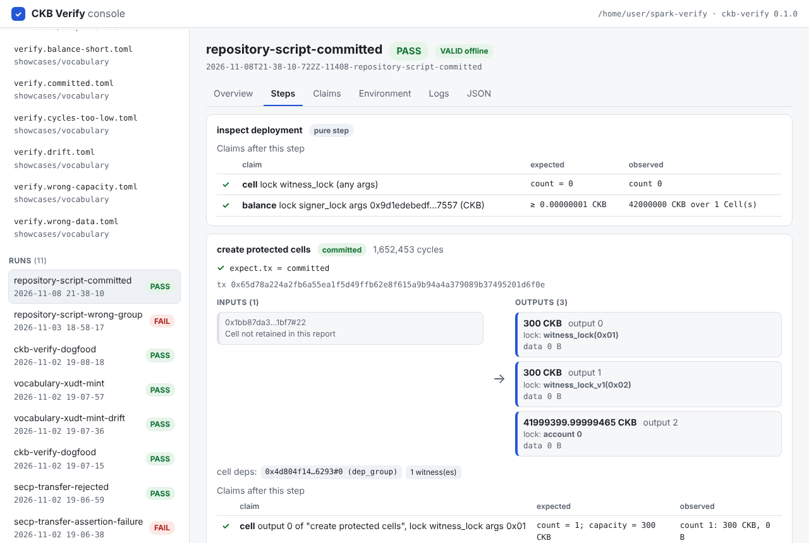
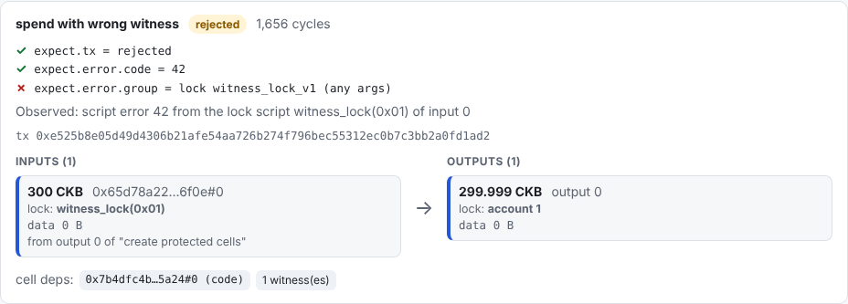

# Local console (`ckb-verify ui`)

The console is an interactive front end to the same runner and verifier the CLI uses. It is local: it binds `127.0.0.1` and serves nothing to the network.

```bash
bunx ckb-verify ui            # or: bun run src/cli.ts ui   (from a checkout)
# CKB Verify console: http://127.0.0.1:4173/
```

Open the printed address in a browser. `--port <n>` picks another port (`0` lets the system choose).



## What you can do

| Task | Where | What happens |
| --- | --- | --- |
| Validate a manifest | sidebar → a `verify*.toml` | Strict parse plus the published schema, with every problem and its key path. A summary lists accounts, setup scripts, steps (pure or transaction), and the claim count. Nothing is executed. |
| Run a manifest | manifest page → **Run on a fresh devnet** | Exactly what `ckb-verify run` does, on a fresh OffCKB devnet. The run's stages appear live (`preflight`, `devnet`, `setup`, then each step's `command`, `result`, `submission`, and `claims`, then `final claims`, `report`). **Cancel** stops the run and cleans up. |
| Understand a failure | the run panel | A run that ends without a verdict shows the stage it stopped in, with a hint about who owns the problem. The step's own `command` stage is the project's code; `devnet` is the toolchain; `manifest` is the `verify.toml`. A FAIL lists each failed expectation and claim with expected and observed values. |
| Read a report | sidebar → a run | **Overview**: verdict, offline validity, both digests, replay status, what failed. **Steps**: every transaction drawn as input and output Cells, with locks and types named (`account 1`, `witness_lock(0x01)`, `xudt(…)`). Inputs created by earlier steps are linked to them. Each step's checks show ✓/✗. **Claims**: one table. **Environment**: toolchain, genesis, sealing, deployed scripts. **Logs**: each step's stdout, stderr, and debugger output. **JSON**: the raw report. |
| Compare two runs | run → Overview → **Compare** | Shows whether the outcome and environment digests agree, and lists each claim or step that differs. |
| Verify someone else's report | **Verify a report…** | Paste or upload a `report.json`. Claims, verdict, digests, and schema are re-derived offline, as `ckb-verify digest` does. A tampered report shows INVALID with the reason. |

A failed expectation is shown next to what was observed. In this example the rejection came from `witness_lock(0x01)`, not from the group the manifest pinned:



## Safety

- **Trusted code only.** A run executes the manifest's commands from your repository, exactly as `ckb-verify run` does. Run only repositories you trust; the console adds no sandbox.
- **Local access only.** The server listens on `127.0.0.1` only.
- **Its own Host names only.** It answers only to the `127.0.0.1` and `localhost` Host names, so a web page cannot reach it through DNS rebinding.
- **A token on every call.** Every API call must carry a random per-server token that is embedded in the page. Another site's page cannot read that token, so it cannot drive the console.
- **No file access beyond the listings.** The console reads only the `verify*.toml` files it lists (`node_modules`, `.ckb-verify`, `.git`, and `dist` are skipped) and run directories under `.ckb-verify/runs/`.
- **Untrusted reports are displayed as text.** A pasted report is never executed or rendered as HTML.
- **`--allow-host <name>`** accepts one more Host name, for a reverse proxy you run yourself. `--allow-host '*'` accepts any Host name and gives up the rebinding check, so use it only behind a proxy you control.
