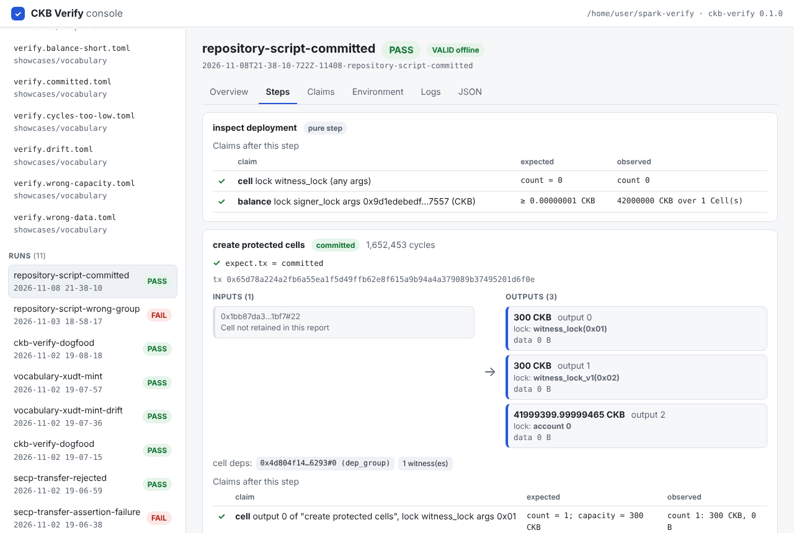

# Spark 提案否决复盘与后续方向（2026-11-08）

## 1. 摘要

- **结果。** Spark 委员会于 2026-11-05 在 [Nervos Talk 帖子 #20](https://talk.nervos.org/t/spark-program-spark-verify-reproducible-acceptance-checks-for-ckb-projects/10598/20) 否决了提案，理由有两条：
  1. 工具没有真正减少开发者和审核者的工作量；
  2. manifest 格式可能变成额外的维护负担，而且运行失败时说不清失败的原因。
- **判断：两条理由都部分成立。**
  - 第一条针对的是我们当时的定位："降低第三方审核者的工作量"。按这个定位，委员会基本是对的，问题出在定位上，不在工具能力。
  - 第二条里，"维护负担"是真实成本。"失败说不清原因"在当时属实，但这是可以用工程手段解决的，本次已经补上。
- **我方的失误。** 2026-11-03 Hanssen 建议把"CKB 交易的自动化测试和 CI 回归"作为核心用例，我们在回复（[#19](https://talk.nervos.org/t/spark-program-spark-verify-reproducible-acceptance-checks-for-ckb-projects/10598/19)）里明确拒绝了这个方向。现在回头看，这是这次评审中我方最大的判断失误。
- **决定。** 不放弃，在没有资助的情况下独立继续。定位调整为"开发者在 CI 里反复运行的交易流程验收与回归测试"，审核者是次要受益方。
- **本次交付：**
  - 可交互的本地控制台 `ckb-verify ui`；
  - 运行失败时的"停止阶段"诊断，直接回应理由二；
  - 加上此前已完成、待合并的 spec `0.2.0`（仓库脚本部署、pure step、error group 等）。

## 2. 时间线

| 日期 | 事件 |
| --- | --- |
| 08-10 | 提交提案 |
| 08-13 | 委员会要求明确第 5 周的示例项目和报告格式；Hanssen 建议给出逐行解释或可视化 |
| 09-24 | 因一个月未互动被关闭，我方回复后重新开放 |
| 09-30 | 回复：示例选用 CKB-UGMP，说明报告格式，补充逐行指南 |
| 10-10 | 委员会表示仅凭文字难以理解工具用途，要求提供演示视频 |
| 10-15 | 提交 Spore mint 的工作流视频 |
| 11-03 | Hanssen 提问：用户是谁？配置文件为审核者带来了什么？演示里只检查一个输出条件，不比交易可视化更易读。建议以交易自动化测试和 CI 回归为核心 |
| 11-03 | 我方回复：不把自动化测试作为方向，长期转向"二进制可复现"研究 |
| 11-05 | 委员会否决 |
| 11-05 | 我方回复：理解决定，将独立继续，欢迎反馈 |

## 3. 理由逐条评估

### 理由一："没有减少开发者和审核者的工作量"

委员会的原话大意是：审核者仍需理解项目主张、检查 `verify.toml` 和配套脚本是否正确、判断断言是否充分；工具只是多加了一层抽象，并没有去掉对领域知识和人工检查的需要。用户是谁、能否省时间，这个问题仍未得到回答。

**成立的部分：**

- 工具不替代判断。断言是否充分，仍要由懂项目的人来决定，我方 11-03 的回复自己也承认了这一点。
- 没有任何外部证据证明"省时间"。第 3 周和第 8 周检查点的记录都是"未发出外联"：没有试用者、没有维护者反馈，也没有第三方从零运行的计时。
- 演示用例太单薄。只检查一个输出条件，看不出比直接看交易图更省事；多用例、负例和回归的价值都没有展示出来。

**不完全成立的部分：**

- 工具省掉的是"可重复执行"这部分体力活：
  - 在干净的 devnet 上搭环境；
  - 钉住版本；
  - 由运行器提交交易；
  - 捕获拒绝原因和脚本组；
  - 生成结构化的预期与观测对照；
  - 给出可离线复核的摘要。

  在同一组主张需要多次、由多人重跑的场景里，这些劳动是真实存在的。
- 但这份价值主要落在作者和开发者自己身上，即修改代码后用同一组用例回归，而不是落在一次性的外部审核上。

**结论：** 针对"降低审核者工作量"这一主张，委员会的判断成立；问题在定位和证据，不在能力。

### 理由二："manifest 是维护负担，失败时说不清原因"

- **维护负担：成立。**
  - 任何测试资产都要维护，OffCKB、CCC、ckb-debugger 也都在快速迭代。
  - 我们的缓解手段，包括精确的版本钉住、冻结的 spec 标识、显式的漂移开关，只能让成本变得可见，不能消除成本。
  - 只有当 manifest 同时充当开发者自己的回归测试时，这笔维护才值得付出。这再次指向理由一的定位问题。
- **失败说不清原因：当时部分成立。**
  - 当时已有的：退出码 0/1/2，用来区分"声明失败"和"无结论"；FAIL 时逐字段列出预期与观测。
  - 当时缺的：无结论的运行只留下一行错误信息，读者看不出问题出在项目、工具链还是 `verify.toml`。
  - 本次已补：每个无结论的运行都会标注停止阶段。阶段依次为 `manifest`、`preflight`、`devnet`、`setup`，然后是每个步骤的 `command`/`result`/`submission`/`claims`，最后是 `final claims`、`source guard`、`report`、`cleanup`。控制台还会给出归属提示，例如"`command` 阶段是项目自己的代码，请看它的 stderr""`devnet` 阶段是工具链问题，不是你的项目"。

### 我方自身的问题

1. 拒绝了委员会给出的、最可能成立的方向（CI 中的交易流程测试），转而提出更远、更难的研究方向。
2. 外部验证一直没有做。外联文案在 11-02 已获批准，但至今没有发出。
3. 演示和叙述偏重严谨性（摘要、可复现、篡改检测），对"谁、在什么时候、省了什么事"回答得不具体。
4. 后期的大量工程投入（冻结契约、供应链门禁、证据包）提高了可信度，但对委员会的核心问题帮助有限。

## 4. 后续方向（无资助，独立推进）

**定位。** CKB 交易流程的可执行验收与回归测试：

- **主要用户**是写合约或 DApp 的开发者，他们编写 `verify.toml`，在 CI 里每次提交都跑一遍；
- **次要用户**是维护者和审核者，他们读报告、离线复核、比较两次运行。

**近期计划：**

1. 合并 PR #47，内容包括 spec `0.2.0`、控制台和阶段诊断；然后冻结新的候选版本，跑齐发布门禁，发布 GitHub release（不发 npm）。
2. 做一个回归示例：用一个带自定义脚本的合约仓库，写一份多用例 manifest。同一组用例在合约修改前后各跑一次，展示它能抓住回归。`0.2.0` 的仓库脚本部署、error group 和 pure step 正好支持这一点。
3. 发出已获批的两份外联（OffCKB 维护者问题、CKB-UGMP 试用请求），并记录一次第三方从零运行的实际耗时。
4. 量化"省时间"：对同一组检查，比较手工 RPC 和用 `ckb-verify` 各需要的步骤数与时间。

**暂不做：** 主网和测试网执行、钱包 UI、托管仪表盘、二进制复构研究（推迟）。

**其他影响：**

- 与资助相关的完成报告和预算报告不再适用，保留为历史草稿。
- 发布不再受 Spark 的时间表约束，但 `elliptic` 豁免于 2026-11-25 到期，这仍是硬约束。续期方案已经准备好（`docs/waiver-renewal-fallback.md`）。

## 5. 本次交付：可交互的本地控制台

启动命令是 `ckb-verify ui`，地址为 `http://127.0.0.1:4173/`。说明见 [docs/console.md](../console.md)。

| 能做什么 | 说明 |
| --- | --- |
| 校验 manifest | 严格解析加 JSON Schema，逐条列出问题和键路径；不执行任何东西 |
| 一键运行 | 在全新 devnet 上执行，实时显示阶段，可以取消 |
| 失败归因 | 无结论时显示停止阶段和归属提示；FAIL 时列出每个失败的期望与声明 |
| 看懂报告 | 每笔交易画成"输入 Cell → 输出 Cell"，锁和类型脚本显示为可读的名称（`account 1`、`witness_lock(0x01)`），输入会关联到前面步骤产生的输出；每项检查标 ✓/✗；另有日志和原始 JSON |
| 比较两次运行 | outcome 和 environment 摘要是否一致，以及逐条声明的差异 |
| 离线校验他人报告 | 粘贴或上传 `report.json`，重新推导声明、结论和摘要；被篡改的报告显示 INVALID |

**验证情况：**

- 控制台单元测试 14 个，阶段诊断测试 6 个，全部通过。
- 用真实浏览器（Playwright）做了端到端走查：从界面启动真实 devnet 运行，得到 PASS，然后逐一查看步骤、声明、环境和比较；还查看了一次 FAIL 运行、一次显示停止阶段的无结论运行、对一份被篡改报告的离线校验（显示 INVALID），以及手机宽度下的布局。全程前端零报错。

**安全：**

- 只监听 127.0.0.1，只接受自己的 Host 名，以防 DNS 重绑定。
- 每个 API 请求都需要每次启动随机生成的令牌，其他网页无法驱动控制台。
- 只读取它自己列出的 manifest 和运行目录。
- 粘贴进来的报告一律按文本显示，不会当作 HTML 渲染，也不会执行。
- 运行仍然执行仓库里的命令，所以只适用于可信的仓库，这一点与 `ckb-verify run` 相同。

## 6. 需要你决定的事

1. 是否合并 PR #47。它目前包含 spec `0.2.0`；控制台和阶段诊断会作为新提交追加到同一分支。
2. 是否把新定位（开发者回归测试优先）写进 README 和 `docs/spark-proposal.md` 顶部的状态说明。
3. 是否在 Nervos Talk 帖子补一条简短回复（可选）。草稿于 2026-11-11 按维护者的要求重写：只说明项目已开源并征集反馈，不回应否决理由，也不解释方向变化。它引用 `v0.1.0` 的 release 页面，所以要等 `v0.1.0` 发布之后再发：

> Hi all, a short update on CKB Verify.
>
> CKB Verify v0.1.0 is out, open source under the MIT license:
> <https://github.com/Akane-CN/spark-verify/releases/tag/v0.1.0>
>
> It runs the transaction flows you declare in `verify.toml` on a fresh local devnet and checks every declared result: whether a transaction is committed or rejected (with the error code and the script group), its cycles, and the Cells and balances it leaves behind. It can deploy your own script binaries, run in CI through a reusable GitHub workflow, and show each run in a local console.
>
> The release page has the install steps (Linux x64, Bun 1.2.19).
>
> Feedback is very welcome. If you try it, please open an issue and tell me what worked and what got in the way.
